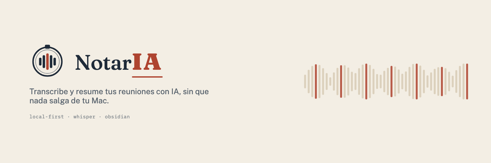
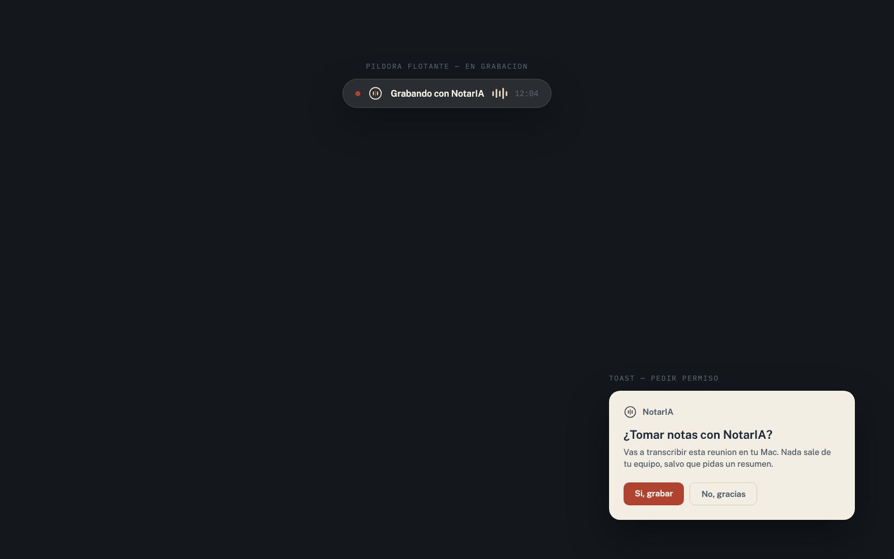

# NotarIA

> Local-first meeting notes for macOS. **Nota** + **IA**, with a nod to
> "notaría" (notary): it bears witness to what was said in the meeting,
> without the conversation ever leaving your machine.



NotarIA listens to your meetings (system audio + microphone, without joining
the call), transcribes them **on-device** with [whisper.cpp](https://github.com/ggml-org/whisper.cpp),
and merges the transcript with your own notes using Claude into a Markdown
note that lands in your Obsidian vault. Audio never leaves your Mac.

Leer esto en español: [README.es.md](./README.es.md)

## Why

Most AI meeting-notes apps are closed boxes: your audio goes to someone
else's cloud, and your notes live in someone else's proprietary workspace.
NotarIA flips both: transcription runs locally with whisper.cpp, and the
only thing that ever leaves your Mac — and only if you opt in — is text sent
to Claude to turn a raw transcript into a structured note. The note itself is
a plain `.md` file in your own Obsidian vault, not a row in someone else's
database.

## How it works

1. **Capture** — ScreenCaptureKit (system audio) + AVAudioEngine (mic), two
   channels (mic = you, system = everyone else).
2. **Transcribe** — whisper.cpp with Metal, on-device, chunked with overlap
   and basic voice-activity detection.
3. **Enhance** (opt-in) — Claude merges the transcript with your quick notes
   into a structured Markdown note. Only text is sent, never audio.
4. **Write** — a dated `.md` note lands in your Obsidian vault, with
   frontmatter (title, date, participants, duration) and a collapsible
   transcript.



## Features

- **Meeting detection** — Detects meetings via your local calendar (EventKit)
  or microphone in use; shows a one-click "record this meeting?" prompt when
  a call is detected.
- **Recording** — Captures system audio + microphone to separate channels,
  with a persistent `● REC` indicator and a floating pill that shows live
  transcript on hover. Pause, resume, and stop from the pill or menu.
- **Transcription** — 100% on-device with whisper.cpp and Metal acceleration;
  no audio ever leaves your Mac.
- **Your own notes** — Edit notes in the main window while recording; on
  enhance, Claude merges your notes with the transcript into a single,
  coherent note.
- **Main window** — Navigable UI with five tabs:
  - *Today*: your calendar agenda for the day and a brief of the next meeting
    based on previous meetings with the same people.
  - *History*: searchable list of all recorded meetings with full-text search
    (FTS5) over encrypted local cache.
  - *Details*: each meeting shows your notes, the diarized transcript (with
    speaker attribution from calendar attendees), and a direct link to edit
    it in Obsidian.
  - *Chat*: ask questions about your own meeting history ("what did I commit
    to Ana?") or apply reusable recipes/templates (follow-up email, action
    items, executive summary) to any meeting.
  - *Settings*: configure your AI model, Obsidian folder, import/export,
    permissions, and more.
- **Import** — Bring your existing notes from other sources: plain markdown
  (`.md` / `.txt`), video-call transcripts (`.vtt` / `.srt` from Zoom/Teams/Meet),
  or structured JSON. Each import is idempotent (same file → same meeting,
  no duplicates).
- **Export** — Copy notes with formatting, save to PDF, or push directly to
  Notion or Slack.
- **Obsidian vault** — Each note is a dated Markdown file with frontmatter
  (title, attendees, duration) and a collapsible transcript; write directly
  to your vault, with stubs for people and companies linked from attendees.
- **Chat with history** — A read-only local MCP server (`aria-capture mcp`)
  so Claude or other tools can search and read your meeting history without
  sending anything to the cloud.
- **Dictation mode** — Record microphone only (no system audio) for quick
  voice notes.
- **Your choice of AI model** — Automatically pick your backend:
  - Claude Code CLI (if installed; no extra cost beyond subscription).
  - Anthropic API (bring your own key, stored in Keychain).
  - OpenAI-compatible endpoints (OpenAI, OpenRouter, Groq, LM Studio, or
    your own server).
  - Ollama (local, on-device; no API key needed, nothing leaves your Mac).

## Privacy

- Audio is transcribed on-device and **never leaves your Mac**.
- Only text (transcript + your notes) is sent to Claude during the enhance
  step, and that step is fully opt-in — NotarIA also works 100% offline.
- A persistent `● REC` indicator is shown while recording; there is no
  silent recording mode. You are responsible for getting consent from other
  participants per your local laws.
- Sensitive fields in the local cache (titles, transcript text, notes) are
  encrypted at rest with AES-GCM; the key lives in the macOS Keychain.
- Secrets (the optional Anthropic API key) are stored only in Keychain, never
  on disk or in the repo.

See [`docs/ARCHITECTURE.md`](./docs/ARCHITECTURE.md) and
[`docs/DECISIONS.md`](./docs/DECISIONS.md) for the full design rationale.

## Requirements

- macOS 14 (Sonoma) or later, Apple Silicon recommended (whisper.cpp uses
  Metal for transcription).
- Xcode 15+ (the full Xcode.app, not just the Command Line Tools — the build
  and test scripts need the bundled toolchain for XCTest and Swift
  concurrency).
- Permissions: **Microphone**, **Screen Recording** (needed to capture
  system audio, not your screen — macOS bundles both under this permission),
  and optionally **Calendar** for meeting detection.

## Build

```bash
git clone https://github.com/criguex/notaria.git
cd notaria
./scripts/build.sh   # swift build, using Xcode's toolchain
./scripts/test.sh    # headless unit tests, no GUI/audio/focus changes
```

To run the menu-bar app directly during development:

```bash
swift run aria-capture menubar
```

See `aria-capture` with no arguments for the full list of CLI subcommands
(transcribe, enhance, chat, search, recipe, brief, calendar, mcp, config,
import-granola, …) — the menu-bar app is a thin SwiftUI shell over the same
core.

## AI Providers

All notes are free to generate with transcription alone. If you want Claude
to enhance your notes, pick a backend — NotarIA checks them in this order,
and you can override in Settings:

1. **Claude Code CLI** — if installed with an active subscription, NotarIA
   uses `claude -p` for free. No extra cost, no API key needed.
2. **Anthropic API** — store your key in Keychain:

   ```bash
   security add-generic-password -s aria-anthropic -a aria -w 'sk-ant-...' -U
   ```

   Get a key at [console.anthropic.com](https://console.anthropic.com) →
   API Keys.

3. **OpenAI-compatible** — point NotarIA to any OpenAI-compatible endpoint
   (OpenAI, OpenRouter, Groq, LM Studio, or your own) and add your API key
   to Keychain.

4. **Ollama** — run `ollama serve` locally (e.g., `ollama pull mistral`);
   NotarIA detects it and uses it with zero configuration. Everything stays
   on your Mac.

Without any of these, NotarIA still works: `enhance --offline` produces a
note from the raw transcript and your own notes, with no AI step.

## Project layout

```
PLAN.md                     Public roadmap (done / backlog)
Package.swift                Swift package (executable: aria-capture)
Sources/aria-capture/         App + CLI source
Tests/AriaTests/              Headless unit tests
Vendor/whisper.cpp/           Vendored whisper.cpp (MIT), see its own LICENSE
docs/                         Architecture, decisions, main-window spec
scripts/build.sh, test.sh     Build and test entry points
```

## Contributing

See [CONTRIBUTING.md](./CONTRIBUTING.md).

## Security

See [SECURITY.md](./SECURITY.md) for how to report a vulnerability.

## License

MIT — see [LICENSE](./LICENSE). The vendored `Vendor/whisper.cpp` keeps its
own MIT license and copyright notice.
